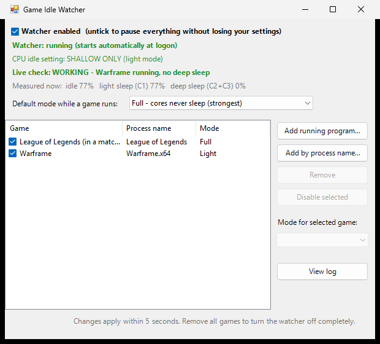

# Game Idle Watcher

Stops your CPU cores from going to sleep while you play, to prevent micro-stutters and random FPS drops. Turns back off when the game closes.

CPU cores drop into sleep modes (C-states) to save power, and waking them back up takes a tiny moment. In games that can show up as stutters. Turning off Global C-States in the BIOS fixes that, but it also keeps the CPU awake all the time. This does the same thing only while a game is running.



## Install

1. Download the ZIP (**Code → Download ZIP**) and extract it somewhere permanent. Keep all files in the same folder.
2. Double-click **`GameIdleWatcher.bat`**. No admin needed.
3. If Windows shows "Windows protected your PC", click **More info → Run anyway**.

That's it. As long as at least one game is in the list, the watcher is installed automatically, runs hidden in the background and starts at every logon. You can close the window; it doesn't need to stay open.

If you move the folder, just open `GameIdleWatcher.bat` again and it repairs itself.

## Settings window

- **Watcher enabled**: untick to pause everything (for example to compare with and without the fix). Your games and modes are kept; tick it again to resume.
- **Status**: whether the watcher is running and which CPU idle setting is applied right now.
- **Live check**: measures what the cores are actually doing (idle, light sleep C1, deep sleep C2+C3) and says whether it's WORKING, NOT WORKING, STUCK or inactive.
- **Default mode**: the mode used for games that don't have their own (see below).
- **Add running program...**: start the game, then pick it from the list of open programs.
- **Add by process name...**: type the `.exe` name (Task Manager → Details).
- **Remove** a game.
- **Checkbox / Disable selected**: turn a single game off without removing it. Disabled games are greyed out and ignored.
- **Mode for selected game**: Default, Full or Light per game.
- **View log**: opens `log.txt`, which records when the watcher started, when games opened/closed, mode changes, and when the fix turned on/off.

Changes apply within 5 seconds, no restart needed.

## Modes

| Mode | What it does | Trade-off |
|---|---|---|
| **Full** | Processor idle disable = on. Cores never sleep, same effect as Global C-State Control = Disabled in the BIOS. | Strongest fix, most heat and power while gaming. |
| **Light** | Idle promote/demote thresholds = 100%. Cores still use the shallow C1 state (wakes almost instantly) but never enter the deeper, slow-to-wake states. | Less heat and power. Try it; if stutters come back, switch to Full. |

The default mode starts as Full and is saved in `settings.txt`. Each game can override it. If several listed games run at once and any of them wants Full, Full is used.

## Games list

The list lives in `games.txt`, one game per line. It's created from `games.default.txt` the first time you run the app, and it's yours: updating the app doesn't overwrite it. You can edit it by hand too:

```
League of Legends  # League of Legends (in a match only)
Warframe.x64 | light  # Warframe
Cyberpunk2077 | off  # Cyberpunk 2077
```

The first part is the process name (the `.exe` name without `.exe`). Optional flags: `| full` or `| light` sets that game's mode, `| off` disables it. The text after `#` is the display name. Included by default:

| Game | Process | When it kicks in |
|---|---|---|
| League of Legends | `League of Legends` | During a match (not in the client/lobby) |
| Warframe | `Warframe.x64` | Whenever the game is open |

## Uninstall

To turn it off temporarily, untick **Watcher enabled**. To remove it completely, remove all games from the list. The watcher is removed (no logon task, nothing running) and CPU idle states go back to normal. Then you can delete the folder.

## How it works

Every 5 seconds `GameIdleWatcher.ps1` re-reads `games.txt` and `settings.txt` and checks whether a listed game is running. If one is, it changes the active power plan: **Processor idle disable** (`IDLEDISABLE`) on in Full mode, or **Processor idle promote/demote threshold** (`IDLEPROMOTE`/`IDLEDEMOTE`) at 100% in Light mode. Idle stays changed until the last listed game closes, then it's restored. It also restores normal idle every time it starts, so it can't get stuck on.

The watcher runs as a per-user scheduled task named **Game Idle Watcher** (at logon, hidden). `GameIdleWatcher-Settings.ps1` is the settings window; `GameIdleWatcher.bat` opens it.

Notes:

- Task Manager will **not** show 100% CPU while it's active on newer Windows 11 builds. Use the live check in the settings window instead.
- On laptops it only applies while plugged in (AC power).
- Expect slightly higher power draw and temperatures while a game is running.
- It only helps if the stutter is caused by cores waking up from sleep. If nothing improves after a few games, remove all games to turn it off.
